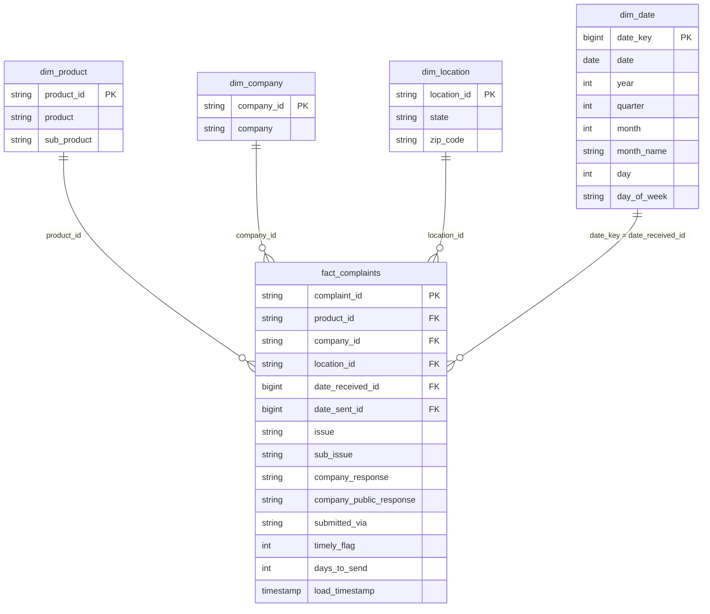

# Consumer Financial Complaint Analytics Lakehouse

An end-to-end data lakehouse pipeline built on Apache Spark and Delta Lake using the Medallion Architecture (Bronze, Silver, Gold) to ingest real consumer complaint data from the CFPB, validate and deduplicate records, model it as a star schema, and serve it to Power BI together with pipeline audit logs.

---

## Project Overview
- **Domain:** Financial Services / Consumer Complaint & Risk Analytics
- **Data Source:** CFPB Consumer Complaint Database API — real, live, publicly available complaint records against financial companies, fetched using Elasticsearch `search_after` cursor pagination.
- **Platform Stack:** Databricks (Apache Spark), Delta Lake, Python / PySpark, Power BI
- **Course:** Data Analysis and Visualization — Semester Project (Phase 3 Complete)
- **Project Team:**
  - Salman Ali — Roll Number: 24L2542
  - Ahmad Khan — Roll Number: 24L2541

---

## Why This Data Source
Unlike a static synthetic dataset, the CFPB API provides genuinely live data: a Full Load is pulled as a historical baseline over a fixed date range, and an Incremental Load is pulled separately for complaints received after that cutoff — mirroring how a real production pipeline ingests new records as they arrive.

---

## Architecture: Medallion Pipeline
The lakehouse pipeline processes complaint data across distinct, fault-tolerant tiers:

    Raw Data (CFPB API — JSON via search_after)
              │
              ▼
┌────────────────────────────────────────────────────────┐
│             Bronze Layer (Delta Lake)                  │  <-- Raw Ingestion + Audit Metadata
│  - Partitioned by run_date with idempotent overwrite   │      (load_timestamp, batch_id, run_date)
│  - Schema drift: new columns kept in extra_columns     │
└────────────────────┬───────────────────────────────────┘
                     │
                     ▼
┌────────────────────────────────────────────────────────┐
│             Silver Layer (Delta Lake)                  │  <-- Cleansed & Standardized
│  - Try-to-timestamp date parsing & type casting        │  - Duplicate Complaint Removal (Window)
│  - Quarantine routing for malformed records            │  - Idempotent MERGE INTO deduplication
└────────────────────┬───────────────────────────────────┘
                     │
                     ▼
┌────────────────────────────────────────────────────────┐
│             Gold Layer (Delta Lake, Star Schema)       │  <-- Business-ready model
│  - dim_product, dim_company, dim_location, dim_date    │  - Hash surrogate keys
│  - fact_complaints (MERGE on complaint_id)             │  - OPTIMIZE + ZORDER for reads
└────────────────────┬───────────────────────────────────┘
                     │
                     ▼
┌────────────────────────────────────────────────────────┐
│     Power BI (Databricks SQL Warehouse, Import mode)   │  <-- Executive dashboard +
│  - Star schema semantic model, DAX measures            │      pipeline audit monitor
└────────────────────────────────────────────────────────┘

          Audit Logging & Orchestration (all layers)
          pipeline_execution_logs · pipeline_watermark · silver_quarantine

---

## Data Models & Schemas

### 1. Bronze Table (`workspace.complaints.bronze_complaints`)
- **Description:** Raw ingestion layer storing unvalidated complaint data as strings, partitioned by ingestion date (`run_date`). New source columns that are not part of the expected contract are not dropped; they are stored as JSON in `extra_columns`.
- **Primary Key:** None (Append / Partition Overwrite layer)

| Column Name | Data Type | Nullable | Description |
|---|---|---|---|
| `complaint_id` | string | yes | Raw complaint identifier |
| `date_received` | string | yes | Raw date complaint was received |
| `product` | string | yes | Financial product category |
| `sub_product` | string | yes | Sub-product classification |
| `issue` | string | yes | Primary issue reported |
| `sub_issue` | string | yes | Secondary issue reported |
| `company` | string | yes | Target company name |
| `state` | string | yes | State abbreviation |
| `zip_code` | string | yes | Postal code |
| `submitted_via` | string | yes | Intake channel |
| `date_sent_to_company` | string | yes | Raw date forwarded to company |
| `company_response` | string | yes | Company response status |
| `timely` | string | yes | Timeliness indicator flag |
| `company_public_response` | string | yes | Public response text |
| `tags` | string | yes | Additional complaint tags |
| `load_timestamp` | timestamp | **no** | Timestamp when ingested into Bronze |
| `source_file` | string | yes | Source CSV/API batch file name |
| `batch_id` | string | yes | Unique batch execution ID |
| `load_type` | string | yes | Ingestion mode (`incremental` / `full`) |
| `run_date` | date | yes | Partition date for idempotent overwrites |
| `extra_columns` | string | yes | JSON of any new source columns (schema drift) |

---

### 2. Silver Table (`workspace.complaints.silver_complaints`)
- **Description:** Cleaned, validated, and type-cast analytical table with strict primary key constraints and idempotent deduplication via `MERGE INTO`.
- **Primary Key:** `complaint_id`

| Column Name | Data Type | Nullable | Key | Description |
|---|---|---|---|---|
| `complaint_id` | string | **no** | **PK** | Unique complaint identifier |
| `date_received` | timestamp | yes | | Parsed timestamp of receipt |
| `date_sent_to_company` | timestamp | yes | | Parsed timestamp forwarded to company |
| `product` | string | yes | | Normalized product category |
| `sub_product` | string | yes | | Normalized sub-product |
| `issue` | string | yes | | Primary issue |
| `sub_issue` | string | yes | | Secondary issue |
| `company` | string | yes | | Company name |
| `state` | string | yes | | State code |
| `zip_code` | string | yes | | Postal code |
| `submitted_via` | string | yes | | Intake channel |
| `company_response` | string | yes | | Company response status |
| `company_public_response` | string | yes | | Public response |
| `timely` | boolean | yes | | Timeliness boolean flag |
| `tags` | string | yes | | Complaint tags |
| `load_timestamp` | timestamp | **no** | | Timestamp of last load/refresh |
| `batch_id` | string | yes | | Batch identifier |

---

### 3. Quarantine Table (`workspace.complaints.silver_quarantine`)
- **Description:** Rows that fail validation in Bronze → Silver (empty `complaint_id` or unparseable `date_received`). They are kept for inspection and never block the rest of the batch.
- **Columns:** the 15 raw string columns, plus `quarantine_reason` (string), `source_file` (string), `batch_id` (string), `run_date` (date), `load_timestamp` (timestamp, not null).

---

### 4. Gold Star Schema (`workspace.complaints.*`)
- **Description:** Business-ready dimensional model built from Silver. One fact table (one row per complaint) and four dimensions. Dimension keys are deterministic SHA-256 hashes of the natural key, so rebuilding a dimension never changes the keys already stored in the fact table.

**`fact_complaints`** — Primary Key: `complaint_id`

| Column Name | Data Type | Key | Description |
|---|---|---|---|
| `complaint_id` | string | **PK** | Unique complaint identifier |
| `product_id` | string | FK → `dim_product` | Product / sub-product key |
| `company_id` | string | FK → `dim_company` | Company key |
| `location_id` | string | FK → `dim_location` | State / ZIP key |
| `date_received_id` | bigint | FK → `dim_date.date_key` | Date received (`yyyyMMdd`) |
| `date_sent_id` | bigint | FK → `dim_date.date_key` | Date sent to company (`yyyyMMdd`) |
| `issue` | string | | Primary issue |
| `sub_issue` | string | | Secondary issue |
| `company_response` | string | | Company response status |
| `company_public_response` | string | | Public response |
| `submitted_via` | string | | Intake channel |
| `timely_flag` | int | | 1 = timely response, 0 = not timely |
| `days_to_send` | int | | Days between receipt and forwarding to company |
| `load_timestamp` | timestamp | | When the Gold row was loaded |

**`dim_product`** — Primary Key: `product_id`

| Column Name | Data Type | Key |
|---|---|---|
| `product_id` | string | **PK** |
| `product` | string | |
| `sub_product` | string | |

**`dim_company`** — Primary Key: `company_id`

| Column Name | Data Type | Key |
|---|---|---|
| `company_id` | string | **PK** |
| `company` | string | |

**`dim_location`** — Primary Key: `location_id`

| Column Name | Data Type | Key |
|---|---|---|
| `location_id` | string | **PK** |
| `state` | string | |
| `zip_code` | string | |

**`dim_date`** — Primary Key: `date_key`

| Column Name | Data Type | Key |
|---|---|---|
| `date_key` | bigint | **PK** |
| `date` | date | |
| `year` | int | |
| `quarter` | int | |
| `month` | int | |
| `month_name` | string | |
| `day` | int | |
| `day_of_week` | string | |

#### Entity-Relationship Diagram

`date_sent_id` also references `dim_date.date_key` and is modelled as an inactive relationship in Power BI (only one active relationship is allowed between two tables).

---

### 5. Operational Tables
- **`pipeline_execution_logs`** — one row per logged run: `run_id`, `batch_id`, `layer`, `load_type`, `parameter`, `start_time`, `end_time`, `duration_seconds`, `status` (Success / Failure), `rows_read`, `rows_inserted`, `rows_updated`, `rows_quarantined`, `error_message`. Rows are written by the orchestrator (`orchestrator` layer) and by the Silver → Gold notebook (`gold` layer), and the table is the source of the audit page in Power BI.
- **`pipeline_watermark`** — `layer`, `last_processed_date`, `updated_at`, `last_batch_id`. Auto mode uses it to decide which dates to pull next.

---

## Pipeline Integration & Automation
`Complaint-Analytics-Pipeline.ipynb` (Master Orchestrator) chains every step, so a new incremental load refreshes all layers automatically:

1. `02_ingest_api` — pulls complaints from the CFPB API
2. `03_raw_to_bronze` — loads Bronze
3. `04_bronze_to_silver` — validates, quarantines and MERGEs into Silver
4. `05_silver_to_gold` — rebuilds the dimensions, MERGEs the fact table, runs `OPTIMIZE ... ZORDER BY (date_received_id, product_id)`

If the API reports `UP_TO_DATE`, `ALREADY_EXISTS` or `NO_DATA`, the downstream steps are skipped. The orchestrator can be scheduled as a Databricks Job for daily runs.

---

## Pipeline Run Guide

### 1. Running a Normal Incremental Load
1. Open **`Complaint-Analytics-Pipeline.ipynb`** (Master Orchestrator).
2. Set execution parameters:
   - **`mode`**: `auto` (uses the watermark to pull lagging completed days; the window ends two days before today to allow for the CFPB publishing delay).
   - **`load_type`**: `incremental`
3. Click **Run All**. The orchestrator extracts via `search_after`, loads Bronze via partition overwrite (`replaceWhere`), merges into Silver, and refreshes the Gold star schema.

### 2. Running a Historical Backfill
1. Open **`Complaint-Analytics-Pipeline.ipynb`**.
2. Set execution parameters:
   - **`mode`**: `manual`
   - **`start_date`**: `2026-10-01`
   - **`end_date`**: `2026-10-01`
   - **`load_type`**: `backfill`
3. Click **Run All**. The pipeline fetches the historical window, validates date types safely using `try_to_timestamp`, routes invalid records to `silver_quarantine`, merges clean records without duplication, and refreshes Gold.

### 3. Schema Drift Handling
- **New source column:** detected in `03_raw_to_bronze`, reported as `SCHEMA DRIFT`, and stored as JSON in `extra_columns`; the batch still loads.
- **Missing source column:** filled with `NULL`.
- **Changed data type:** Bronze stores every field as a string, so it cannot fail there. In Silver, rows whose `date_received` or `complaint_id` no longer parse go to `silver_quarantine` with a reason while the rest of the batch continues.

---

## Business Intelligence (Power BI)
- **Connection:** Power BI Desktop connects to the Databricks SQL warehouse (Server Hostname + HTTP Path + personal access token) in **Import** mode.
- **Tables loaded:** `fact_complaints`, `dim_product`, `dim_company`, `dim_location`, `dim_date`, `pipeline_execution_logs`, `silver_quarantine`.
- **Semantic model:** one-to-many relationships from each dimension to `fact_complaints` (single direction, dimension → fact). `dim_date` is marked as the date table. The two audit tables are standalone.

**DAX measures**

| Measure | Definition |
|---|---|
| Total Complaints | `COUNTROWS(fact_complaints)` |
| Timely Rate | share of complaints with `timely_flag = 1` |
| Avg Days to Send | `AVERAGE(fact_complaints[days_to_send])` |
| Products Tracked | `DISTINCTCOUNT(dim_product[product])` |
| Total Runs | `DISTINCTCOUNT(pipeline_execution_logs[run_id])` |
| Success Rate | share of log rows with `status = "Success"` |
| Rows Inserted / Rows Quarantined | sums of the matching log columns |
| Avg Duration (s) | `AVERAGE(pipeline_execution_logs[duration_seconds])` |

**Dashboard pages**
1. **Executive Dashboard** — date, product and state slicers; KPI cards (total complaints, timely rate, average days to send, products tracked); monthly trend line; top products and top companies bars; complaints by state matrix.
2. **Pipeline Operational Audit Monitor** — run, success-rate, rows and duration KPIs; duration and runs-by-status per layer; quarantine reasons; full execution-log audit table.

The Power BI file is in the `Dashboard/` folder.

---

## Key Design Decisions
| Decision | Reason |
|---|---|
| Bronze stores everything as strings | Raw data can never fail on a type surprise; casting and validation happen in Silver, where bad rows can be quarantined. |
| Bronze partitioned by `run_date` with `replaceWhere` | A re-run replaces only its own day, so reloading the same day creates no duplicates. |
| Silver and Gold fact use `MERGE INTO` on `complaint_id` | Inserts new complaints and updates changed ones; running the same input twice leaves the tables identical. |
| Hash (SHA-256) surrogate keys in Gold | Deterministic, so dimensions can be rebuilt without breaking fact-table references. |
| Dimensions overwritten, fact merged | Dimensions are small and derived from Silver; the fact table is large and should only change where data changed. |
| `OPTIMIZE ... ZORDER BY (date_received_id, product_id)` | Co-locates data by the columns most used in dashboard filters. |
| Power BI in Import mode | Faster visuals and no need to keep the SQL warehouse running (Free Edition has a usage quota). |

The architecture diagram, Spark UI DAG analysis, and cost / FinOps evaluation are in the final PDF report in the `docs/` folder.

---

## Repository Structure
    ├── README.md
    ├── .gitignore
    ├── Dashboard/
    │   └── Power BI file (.pbix)
    ├── data/
    │   └── samples/
    │       ├── raw_data_sample.csv
    │       ├── full_load_sample.csv
    │       └── incremental_load_sample.csv
    ├── docs/
    │   ├── DAV_Project_Proposal.docx
    │   └── Final architecture report (PDF)
    └── Notebooks/
        ├── 01_Setup.ipynb
        ├── 02_ingest_api.ipynb
        ├── 03_raw_to_bronze.ipynb
        ├── 04_bronze_to_silver.ipynb
        ├── 05_silver_to_gold.ipynb
        └── Complaint-Analytics-Pipeline.ipynb

---

## Security & Privacy
The CFPB dataset does not include customer names, account numbers, or transaction amounts. It contains only complaint metadata (company, product, state, dates, response status), and ZIP codes arrive already partly masked by the source (for example `604XX`), so they are stored as strings. No direct personal identifiers are present, so no additional hashing or masking is required.
