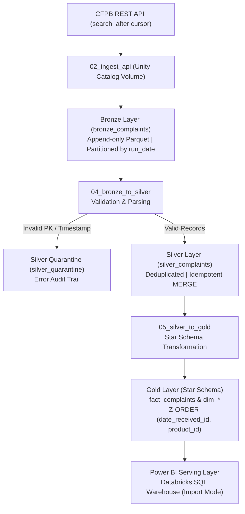
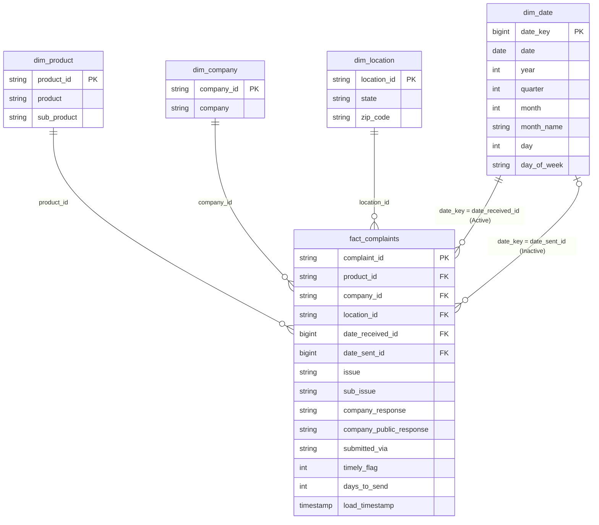

# Consumer Financial Complaint Analytics Lakehouse

An end-to-end data lakehouse platform built on Apache Spark and Delta Lake using the Medallion Architecture (Bronze, Silver, Gold) to ingest real consumer complaint records from the Consumer Financial Protection Bureau (CFPB) API, validate and quarantine malformed records, model the cleansed data into a Kimball Star Schema, and serve interactive analytics through a 3-page Microsoft Power BI reporting suite alongside real-time pipeline audit telemetry.

---

## Project Overview
- **Domain:** Financial Services / Consumer Dispute & Regulatory Risk Analytics
- **Data Source:** CFPB Consumer Complaint Database API — live, publicly available dispute records against financial institutions, fetched via cursor pagination (`search_after`).
- **Platform Stack:** Databricks (Apache Spark), Delta Lake, Python / PySpark, Microsoft Power BI Desktop (Import Mode via Databricks SQL Warehouse).
- **Course:** Data Analysis and Visualization — Semester Project (Phase 3 Complete)
- **Project Team:**
  - Muhammad Ahmad Khan — Roll Number: 24L-2541
  - Muhammad Salman Ali — Roll Number: 24L-2542

---

## Why This Data Source
Unlike static synthetic datasets, the CFPB API provides authentic production data:
1. **Full Baseline Load:** Historical baseline extracted across an initial fixed time window.
2. **Incremental Delta Loads:** New records extracted dynamically after the established watermark date.
3. **Cursor Pagination:** Handles high-volume daily batches using the API's Elasticsearch `search_after` cursor, circumventing the default 1,000-row query ceiling.

---

## Architecture: Medallion Lakehouse Pipeline



---

## Data Models & Schemas

### 1. Bronze Table (`workspace.complaints.bronze_complaints`)
Raw ingestion layer storing source records as strings to prevent ingest failures from upstream schema changes. Physically partitioned by `run_date`.

| Column Name | Data Type | Nullable | Description |
|---|---|---|---|
| `complaint_id` | string | yes | Raw complaint identifier |
| `date_received` | string | yes | Raw date received by CFPB |
| `product` | string | yes | Financial product category |
| `sub_product` | string | yes | Sub-product classification |
| `issue` | string | yes | Primary issue reported |
| `sub_issue` | string | yes | Secondary issue reported |
| `company` | string | yes | Regulated financial company name |
| `state` | string | yes | Two-letter state postal abbreviation |
| `zip_code` | string | yes | Postal code (often masked at source) |
| `submitted_via` | string | yes | Intake channel (Web, Phone, Referral, etc.) |
| `date_sent_to_company` | string | yes | Raw date forwarded to financial institution |
| `company_response` | string | yes | Formal response classification |
| `timely` | string | yes | Raw timeliness indicator |
| `company_public_response` | string | yes | Public remarks from the company |
| `tags` | string | yes | Consumer demographic/military tags |
| `load_timestamp` | timestamp | **no** | UTC ingestion timestamp |
| `source_file` | string | yes | Source file name |
| `batch_id` | string | yes | Unique batch execution UUID |
| `load_type` | string | yes | Ingestion mode (`incremental` / `full` / `backfill`) |
| `run_date` | date | yes | Partitioning date for atomic directory overwrites |
| `extra_columns` | string | yes | JSON payload capturing unmapped schema drift columns |

---

### 2. Silver Table (`workspace.complaints.silver_complaints`)
Cleansed, validated, and type-cast analytical table with deduplication committed via Delta `MERGE INTO`.

| Column Name | Data Type | Nullable | Key | Description |
|---|---|---|---|---|
| `complaint_id` | string | **no** | **PK** | Unique complaint identifier |
| `date_received` | timestamp | yes | | Parsed receipt timestamp (`try_to_timestamp`) |
| `date_sent_to_company` | timestamp | yes | | Parsed forwarded timestamp (`try_to_timestamp`) |
| `product` | string | yes | | Cleansed product category |
| `sub_product` | string | yes | | Cleansed sub-product category |
| `issue` | string | yes | | Primary dispute issue |
| `sub_issue` | string | yes | | Secondary root issue |
| `company` | string | yes | | Standardized financial institution name |
| `state` | string | yes | | Cleaned US jurisdiction state code |
| `zip_code` | string | yes | | Cleaned ZIP code |
| `submitted_via` | string | yes | | Intake channel |
| `company_response` | string | yes | | Standardized response status |
| `company_public_response` | string | yes | | Public company remarks |
| `timely` | boolean | yes | | Standardized compliance boolean flag |
| `tags` | string | yes | | Categorical tags |
| `load_timestamp` | timestamp | **no** | | UTC timestamp of last record mutation |
| `batch_id` | string | yes | | Batch identifier |

---

### 3. Quarantine Table (`workspace.complaints.silver_quarantine`)
Isolates records that fail critical quality constraints (missing `complaint_id` or non-parseable timestamps).
- **Columns:** All 15 raw source string fields plus `quarantine_reason` (string), `source_file` (string), `batch_id` (string), `run_date` (date), and `load_timestamp` (timestamp).

---

### 4. Gold Star Schema (`workspace.complaints.*`)
Optimized Kimball dimensional model. Dimension surrogate keys are constructed using deterministic SHA-256 hashes of natural keys, enabling parallel cluster rebuilds without foreign-key invalidation.

#### `fact_complaints` (Primary Key: `complaint_id`)
| Column Name | Data Type | Key | Description |
|---|---|---|---|
| `complaint_id` | string | **PK / DD** | Source CFPB complaint identifier (Degenerate Dimension) |
| `product_id` | string | FK &rarr; `dim_product` | Deterministic SHA-256 key linking to `dim_product` |
| `company_id` | string | FK &rarr; `dim_company` | Deterministic SHA-256 key linking to `dim_company` |
| `location_id` | string | FK &rarr; `dim_location` | Deterministic SHA-256 key linking to `dim_location` |
| `date_received_id` | bigint | FK &rarr; `dim_date.date_key` | Numeric date key (`yyyyMMdd`) for received date |
| `date_sent_id` | bigint | FK &rarr; `dim_date.date_key` | Numeric date key (`yyyyMMdd`) for forwarded date |
| `issue` | string | | Primary complaint issue |
| `sub_issue` | string | | Fine-grained complaint root issue |
| `company_response` | string | | Categorized response code |
| `company_public_response` | string | | Public response text |
| `submitted_via` | string | | Intake submission channel |
| `timely_flag` | int | Metric | Binary compliance flag (1 = Yes, 0 = No) |
| `days_to_send` | int | Metric | Forwarding latency: `DATEDIFF(date_sent, date_received)` |
| `load_timestamp` | timestamp | Audit | UTC timestamp when loaded into Gold |

#### Dimension Tables
- **`dim_product`:** `product_id` (PK, SHA-256), `product`, `sub_product`.
- **`dim_company`:** `company_id` (PK, SHA-256), `company`.
- **`dim_location`:** `location_id` (PK, SHA-256), `state`, `zip_code`.
- **`dim_date`:** `date_key` (PK, bigint `yyyyMMdd`), `date` (date), `year` (int), `quarter` (int), `month` (int), `month_name` (string), `day` (int), `day_of_week` (string).

#### Entity-Relationship Diagram



---

### 5. Operational Telemetry Tables
- **`workspace.complaints.pipeline_execution_logs`:** Captures step-level audit telemetry (`run_id`, `batch_id`, `layer`, `load_type`, `parameter`, `start_time`, `end_time`, `duration_seconds`, `status`, `rows_read`, `rows_inserted`, `rows_updated`, `rows_quarantined`, `error_message`). Powers Page 3 in Power BI.
- **`workspace.complaints.pipeline_watermark`:** Tracks high-water mark metadata (`layer`, `last_processed_date`, `updated_at`, `last_batch_id`) to orchestrate incremental execution windows automatically.

---

## Pipeline Automation & Orchestration

The master notebook **`Complaint-Analytics-Pipeline.ipynb`** chains all execution tiers together:
1. **`02_ingest_api`:** Queries CFPB REST endpoints using `search_after` cursor pagination and stages CSV files in Unity Catalog Volumes.
2. **`03_raw_to_bronze`:** Ingests raw data with lineage tracking and performs partition replacement (`replaceWhere = "run_date = '...'"`).
3. **`04_bronze_to_silver`:** Validates schema, routes anomalies to `silver_quarantine`, executes window-based deduplication, and commits an idempotent `MERGE` into `silver_complaints`.
4. **`05_silver_to_gold`:** Derives conforming dimensions, merges `fact_complaints`, and executes `OPTIMIZE ... ZORDER BY (date_received_id, product_id)` for accelerated read I/O.

The pipeline safely exits downstream executions if the API reports `UP_TO_DATE`, `ALREADY_EXISTS`, or `NO_DATA`.

---

## Business Intelligence (Power BI Desktop)

- **Connectivity:** Azure Databricks SQL Warehouse (Direct connection via Server Hostname, HTTP Path, and Personal Access Token) imported in **Import Mode** for sub-second visual performance.
- **Loaded Tables:** `fact_complaints`, `dim_product`, `dim_company`, `dim_location`, `dim_date`, `pipeline_execution_logs`, and `silver_quarantine`.
- **Relationship Model:** Pure Star Schema with one-to-many (`1:*`) single-direction relationships from each dimension to `fact_complaints`.
- **Role-Playing Calendar:**
  - Active: `dim_date[date_key]` &rarr; `fact_complaints[date_received_id]`
  - Inactive: `dim_date[date_key]` &dash;&rarr; `fact_complaints[date_sent_id]`

### Production DAX Measures (`_Measures` Table)

| Measure Name | DAX Expression | Description / Usage |
|---|---|---|
| **Total Complaints** | `COUNTROWS('fact_complaints')` | Primary volume metric across all visuals |
| **Timely Response Rate** | `DIVIDE(SUM('fact_complaints'[timely_flag]), [Total Complaints], 0)` | % of complaints answered within statutory window |
| **Avg Days to Route** | `AVERAGE('fact_complaints'[days_to_send])` | Average latency in days before forwarding to company |
| **Untimely Complaints** | `CALCULATE([Total Complaints], 'fact_complaints'[timely_flag] = 0)` | Count of complaints violating timeliness SLA |
| **Complaints Sent by Date** | `CALCULATE([Total Complaints], USERELATIONSHIP('fact_complaints'[date_sent_id], 'dim_date'[date_key]))` | Influx line metric leveraging inactive date relationship |
| **Total Pipeline Runs** | `DISTINCTCOUNT('pipeline_execution_logs'[run_id])` | Count of unique orchestrator executions |
| **Pipeline Success Rate** | `COALESCE(DIVIDE(CALCULATE(COUNTROWS('pipeline_execution_logs'), 'pipeline_execution_logs'[status] = "Success"), COUNTROWS('pipeline_execution_logs'), 0), 0)` | Overall orchestration SLA reliability rate |
| **Total Quarantined** | `SUM('pipeline_execution_logs'[rows_quarantined])` | Total records diverted to quarantine |
| **Avg Run Duration (s)** | `AVERAGE('pipeline_execution_logs'[duration_seconds])` | Average execution runtime across layers |

---

### Dashboard Page Architecture (3-Page Layout)

The Power BI report (`Consumer_Complaint_Analytics.pbix`) is structured into three dedicated, uncluttered pages to balance executive KPIs, deep institutional root-cause analysis, and data platform telemetry:

1. **Page 1: Executive Analytics (Consumer Complaint Intelligence)**
   - **Top Slicers:** Date Range Slider (`dim_date[date]`) and Product Dropdown (`dim_product[product]`).
   - **KPI Cards:** Total Complaints, Timely Response Rate, Avg Days to Route, Untimely Complaints.
   - **Intake vs. Routing Trend (Combo Chart):** Compares complaints received vs. routed to companies over time using the inactive relationship on `date_sent_id`.
   - **Product Breakdown (Donut Chart):** Complaint volume distribution across financial product lines.
   - **Geographic Heatmap (Filled Map):** Color-saturated choropleth map highlighting complaint density across US states.

2. **Page 2: Dispute Analytics (Dispute & Root-Cause Intelligence)**
   - **Top 10 Regulated Institutions Resolution Strategy (100% Stacked Bar):** Resolution breakdown (Closed with explanation, Closed with monetary relief, Non-monetary relief, In progress) for top entities like TransUnion, Experian, and Equifax.
   - **Top 10 Consumer Pain Points & Root Issues (Clustered Bar Chart):** Full-width horizontal bar chart decomposing the primary dispute drivers.

3. **Page 3: Pipeline Observability (Data Engineering Telemetry & Audit Trail)**
   - **Operational Slicers:** Filter by layer (`bronze`, `silver`, `gold`, `orchestrator`) and status (`Success`, `Failure`).
   - **KPI Cards:** Total Pipeline Runs, Pipeline Success Rate (SLA %), Total Quarantined, Avg Run Duration.
   - **Layer Latency Profile (Clustered Column Chart):** Average runtime in seconds across pipeline layers.
   - **Ingestion Throughput Funnel (Clustered Bar Chart):** Records ingested vs. quarantined per batch.
   - **Pipeline Execution Audit Log (Data Grid Table):** Comprehensive tabular log with status-based conditional formatting and compact single-line row formatting.

---

## Key Engineering Decisions

| Decision | Technical Justification |
|---|---|
| **Raw String Ingestion in Bronze** | Prevents pipeline aborts caused by unannounced upstream API schema changes or field type mutations. Type casting occurs safely in Silver. |
| **Bronze Partitioning by `run_date`** | Isolates daily batch storage directories, enabling atomic, idempotent partition overwrites (`replaceWhere`) without rewriting historical Parquet files. |
| **Idempotent Delta `MERGE INTO`** | Prevents duplication when backfilling or re-running failed batches; existing `complaint_id` keys update in place while new records insert. |
| **Stateless SHA-256 Surrogate Keys** | Generates deterministic, distributed surrogate keys without inter-worker locks or stateful `monotonically_increasing_id` sequence dependencies. |
| **Z-Ordering on Fact Table** | Clusters Parquet files by `(date_received_id, product_id)`, enabling file skipping via column-level min/max statistics and pruning non-relevant data chunks during BI queries. |
| **Power BI Import Mode** | Delivers instant cross-filtering and dashboard responsiveness without consuming continuous SQL Warehouse cluster compute hours. |

---

## Repository Structure

```text
├── README.md
├── .gitignore
├── Dashboard/
│   └── Consumer_Complaint_Analytics.pbix
├── data/
│   └── samples/
│       ├── raw_data_sample.csv
│       ├── full_load_sample.csv
│       └── incremental_load_sample.csv
├── docs/
│   ├── DAV_Project_Proposal.docx
│   └── Consumer_Financial_Complaint_Analytics_Report.pdf
└── Notebooks/
    ├── 01_Setup.ipynb
    ├── 02_ingest_api.ipynb
    ├── 03_raw_to_bronze.ipynb
    ├── 04_bronze_to_silver.ipynb
    ├── 05_silver_to_gold.ipynb
    └── Complaint-Analytics-Pipeline.ipynb
```

---

## Security, Privacy & PII Handling
To adhere to GLBA, CCPA, and general consumer privacy standards, the pipeline omits unstructured narrative text fields (`complaint_what_happened`) at the Bronze-to-Silver boundary. Only standardized categorical dispute metrics, institutional entity names, dates, and partially masked postal codes (`604XX`) are ingested into the analytical model, eliminating the risk of exposing personal financial records or individual customer identifiers. All workspace secrets and API endpoints are accessed securely via Databricks execution contexts.